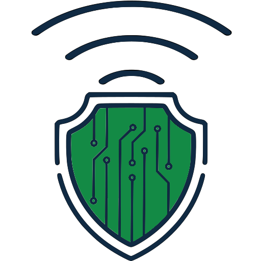

<div align="center">
  
  <h1>Pi Router</h1>
  <p>The router for families who want a safer, more secure home internet without sacrificing privacy</p>
</div>

# How it Works

- The Raspberry Pi 5 router applies firewall and domain policies that block listed web proxies, Tor relays, remote browsers, VPN endpoints, and others before their lookups can leave the router.
- A local Proton VPN tunnel (account required) is used to forward DNS requests to a Cloudflare Families DNS resolver, where Cloudflare sees the VPN exit address, not the household's public IP.
- Traffic that is permitted by the firewall and domain policies is referred to as "permitted traffic".
- Permitted application traffic from normal devices exits through Proton VPN, while permitted application traffic from devices using the application-traffic bypass uses the ISP connection without bypassing the Pi’s DNS, domain, or firewall policies.
- When Proton VPN is unavailable, normal devices cannot access the WAN, while bypassed devices retain WAN connectivity, but generally cannot reach new uncached domains since the Pi cannot complete upstream DNS resolution.
- However, if Proton VPN is attempting to connect, the router creates a temporary gate that permits DNS requests through the ISP, causing Cloudflare to see the household's public IP as well as temporarily allowing new permitted domains to resolve, but this gate closes when each connection process succeeds or fails.

# Required Contents

- Raspberry Pi 5
- Waveshare PCIe to Gigabit Ethernet Board
- micro SD card
- 2x ethernet cables

After assembling the Pi 5 router, choose one of the installation methods below. The Pi Router image already contains Raspberry Pi OS Desktop, so do not flash the stock OS before using that method. The Windows installer and manual setup methods instead begin with a fresh stock Raspberry Pi OS Desktop installation.

For the Windows installer or manual setup, connect the setup computer to the Pi 5's built-in Ethernet port (`eth0`) and connect an upstream router LAN port to the Waveshare PCIe Ethernet port (`eth1`). Image users should instead connect the final topology described below before the first boot.

# Installation Methods

## Image Method

- For the Pi Router image, install Raspberry Pi Imager 2.x and download the `pi-router-vX.Y.Z-pi5-arm64.rpi-imager-manifest` from the GitHub Release assets.
  - Open the manifest with Raspberry Pi Imager. It supplies the Pi Router OS entry and automatically downloads the matching `.img.xz` from the same release.
  - Do not select the raw `.img.xz` through **Use Custom**. During Imager customization, set the username to exactly `admin`, choose a unique password, and configure SSH as desired.
  - Follow the complete [image user guide](image/USER-GUIDE.md) for writing the microSD card, connecting the final topology, and completing Proton onboarding.

## Windows Installer Method

- As an alternative on Windows, use the Windows installer packaged with the latest release.
- A built or downloaded release `*.tar.gz` and `*.sha256.txt` is needed in the same folder as the `*.exe` Windows installer to run it.
- To build `*.tar.gz` and `*.sha256.txt` files, see [Pack / Repack `pi-router-vX.Y.Z.tar.gz`](#pack--repack-pi-router-vxyz-targz) below.

- To build a Windows installer, follow [windows-installer/BUILD.md](windows-installer/BUILD.md).
  - The installer **_may fail_** on various steps due to either ethernet or ssh disconnects. If this happens, retry the installation. If this still does not work, **re-image the Pi 5 with a fresh Raspberry Pi OS Desktop image** and start again.

## Manual Method

- Otherwise, or if using Linux, you may run the setup script steps manually and follow the [manual setup guide](src/setup.md).
  - A built or downloaded release `*.tar.gz` and `*.sha256.txt` is still needed for the manual setup.

# Final Topology

Image users must connect this topology before the first boot. Windows-installer and manual-setup users move the Pi into this topology after installation:

- ISP modem or upstream router -> Pi Waveshare PCIe `eth1`
- Pi built-in `eth0` -> downstream router in Access Point/AP mode

Power off the Pi and downstream access point before changing the connections. If connected directly to an ISP modem, leave the modem unplugged for 1-2 minutes before reconnecting it. Start the modem or upstream router first, then the downstream access point, and finally the Pi.

Image users should continue with the browser-based provisioning and Proton onboarding steps in the [image user guide](image/USER-GUIDE.md).

# Pack / Repack `pi-router-vX.Y.Z.tar.gz`

Create a new archive:

```powershell
$parent = "$env:USERPROFILE\Desktop\GitHubRepos\pi-router"
$release = "pi-router-vX.Y.Z" # Replace with the release version, for example 0.1.0
$releaseDir = "$parent\$release"
$out = "$parent\$release.tar.gz"

Remove-Item $out, $releaseDir -Recurse -Force -ErrorAction SilentlyContinue
Copy-Item "$parent\src" $releaseDir -Recurse

tar -czf $out -C $parent $release
Remove-Item $releaseDir -Recurse -Force
```

Generate new SHA256 text file for verification:

```powershell
$newSha = "$parent\$release.sha256.txt"

(Get-FileHash $out -Algorithm SHA256).Hash | Set-Content $newSha
```

Verify:

```powershell
$expected = (Get-Content $newSha).Trim().ToUpper()
$actual = (Get-FileHash $out -Algorithm SHA256).Hash.ToUpper()

"Expected: $expected"
"Actual:   $actual"

if ($expected -eq $actual) {
    "ARCHIVE VERIFY: PASS"
} else {
    "ARCHIVE VERIFY: FAIL"
}
```

# Unpack `pi-router-vX.Y.Z.tar.gz`

```powershell
$tarFile="pi-router-vX.Y.Z.tar.gz"  # Replace with the release version, for example 0.1.0
$parent = "$env:USERPROFILE\Desktop\GitHubRepos\pi-router"
$in = "$parent\$tarFile"

New-Item -ItemType Directory -Force $parent | Out-Null

tar -xzf $in -C $parent
```
